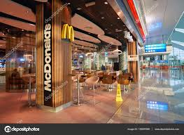

# 🍔 FoodExpress - Food Delivery & Restaurant Ordering Android App

<p align="center">
  
</p>

<p align="center">
  <a href="https://www.android.com/"></a>
  <a href="https://kotlinlang.org/"></a>
  <a href="https://developer.android.com/"></a>
  <a href="https://developer.android.com/"></a>
  <a href="https://github.com/ibrohim2005rajabboyev/FoodExpress/stargazers"></a>
  <a href="https://github.com/ibrohim2005rajabboyev/FoodExpress/network/members"></a>
</p>

---

## 📌 Overview

**FoodExpress** is a native Android food ordering and delivery application developed in Kotlin. The app provides a seamless digital dining experience, enabling users to explore local restaurants, browse popular dishes, manage cart orders with real-time price calculations, and navigate between screens using Android Jetpack Navigation.

---

## 📱 Key Features

- **🍔 Restaurant & Menu Exploration:** Browse top restaurants and popular categories including burgers, lavash, hotdogs, and combo meals.
- **🏷️ Promotional Banner Slider:** Auto-scrolling promotion carousel highlighting daily discounts, combo packages, and special deals.
- **🛒 Dynamic Cart & Checkout:** Real-time quantity controls (increment/decrement), total cost computation, and smooth checkout flow with payment options (Cash, Card).
- **🗺️ Delivery Location & Map:** Integrated map fragment for delivery address selection, GPS coordinates, and route visualization.
- **🔐 User Authentication:** Polished onboarding experience with Splash screen, Login (`SingActivity`), and New User Registration.
- **⭐ Ratings & Customer Feedback:** Restaurant review screen featuring star ratings and feedback submission.
- **🧭 Bottom Navigation:** Fluid tab switching between Home, Map, Cart, and Profile powered by Jetpack Navigation Component.

---

## 🛠 Tech Stack & Libraries

| Component | Technology | Details |
| :--- | :--- | :--- |
| **Language** | [Kotlin](https://kotlinlang.org/) | Modern, concise, and memory-safe programming language |
| **Platform** | [Android SDK](https://developer.android.com/) | Min SDK: 24 (Android 7.0), Target SDK: 35 |
| **UI Framework** | Android XML + ViewBinding | Type-safe, boilerplate-free UI view binding |
| **Navigation** | [Jetpack Navigation](https://developer.android.com/guide/navigation) | Single-activity multi-fragment navigation management |
| **Components** | Google Material Design 3 | Cards, BottomNavigationView, Custom Badges, Buttons |
| **Lists & Grids** | RecyclerView | Optimized multi-type adapters for products, categories & cart |

---

## 📂 Project Architecture

```
FoodExpress/
├── app/
│   ├── src/main/
│   │   ├── java/com/example/foodexpress/
│   │   │   ├── adapter/
│   │   │   │   ├── CartProductAdapter.kt   # Cart items with quantity adjusters
│   │   │   │   ├── CategoryAdapter.kt       # Horizontal food categories adapter
│   │   │   │   ├── CategoryTabAdapter.kt    # Category tab selector adapter
│   │   │   │   ├── ProductAdapter.kt        # Food menu product cards adapter
│   │   │   │   ├── RestaurantAdapter.kt     # Featured restaurants adapter
│   │   │   │   └── SlideAdapter.kt          # Promotional carousel slider adapter
│   │   │   ├── model/
│   │   │   │   ├── CategoryModel.kt         # Food category data entity
│   │   │   │   ├── ProductModel.kt          # Product details, image & pricing model
│   │   │   │   ├── RestaurantModel.kt       # Restaurant profile & rating model
│   │   │   │   └── SlideModel.kt            # Banner promotional slide model
│   │   │   └── screen/
│   │   │       ├── auth/                    # Login (SingActivity) & Registration
│   │   │       ├── main/                    # MainActivity host with BottomNav
│   │   │       │   ├── cart/CartFragment.kt
│   │   │       │   ├── main/MainFragment.kt
│   │   │       │   ├── map/MapFragment.kt
│   │   │       │   ├── order/checkout/CheckoutActivity.kt
│   │   │       │   ├── profile/ProfileFragment.kt
│   │   │       │   └── restaurant/
│   │   │       │       ├── detail/RestaurantDetailActivity.kt
│   │   │       │       └── feedback/FeedbackFragment.kt
│   │   │       └── splash/SplashActivity.kt # App launch splash screen
│   │   └── res/                             # Layouts, vector icons, navigation graphs
│   └── build.gradle                         # App module dependencies
└── settings.gradle
```

---

## 🚀 Getting Started

Follow these steps to run the project locally:

### Prerequisites:
- **Android Studio** (Koala / Ladybug or newer recommended)
- **JDK 17** (or JDK 11+)
- Android device or Emulator running **Android 7.0 (API 24)** or higher

### Installation:
1. Clone the repository:
   ```bash
   git clone https://github.com/ibrohim2005rajabboyev/FoodExpress.git
   ```
2. Open **Android Studio** and click **File > Open**, then select the cloned `FoodExpress` folder.
3. Wait for Gradle to finish downloading dependencies (`Sync Project with Gradle Files`).
4. Select your connected Android device or Emulator.
5. Click **Run** (`Shift + F10`) to build and launch the application.

---

## 👨‍💻 Author

- **Ibrohimjon Rajabboyev**
- **GitHub:** [@ibrohim2005rajabboyev](https://github.com/ibrohim2005rajabboyev)
- **Bio:** Mobile App Developer • Android • Kotlin • Flutter • UI/UX
